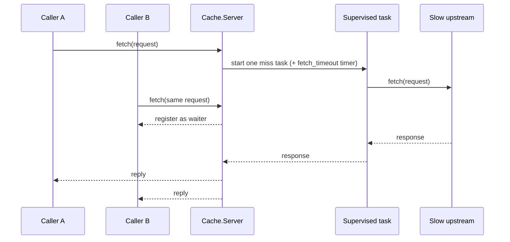

# Cache

An Elixir/OTP read-through cache for a slow upstream `fetch(req) -> res`. It is a single
`GenServer` keyed by request struct and valued by response struct, with:

- a capacity cap and true LRU eviction,
- per-response TTL expiry,
- concurrent misses that never block the server, and coalescing, so callers asking for the
  same in-flight request share one upstream call,
- bounded upstream calls: a raise, a bad result or a timeout fails the waiting callers and is
  never cached, and the cache process itself keeps running.

It implements V0 to V3 of a staged cache exercise (interface, capped FIFO, LRU, LRU + TTL).
V4 (amortised O(1) operations) is out of scope; see [Complexity boundary](#complexity-boundary).
[`ARCHITECTURE.md`](ARCHITECTURE.md) has the module diagram, data flows and the state layout.

## Running

The toolchain is pinned in `.tool-versions` (Erlang/OTP 29.1.2, Elixir 1.20.5). There are no
Hex dependencies.

With Docker, using the official `elixir` image:

```
docker build -t cache .
docker run --rm cache                  # mix check: format, warnings-as-errors compile, tests
docker run --rm -it cache iex -S mix   # interactive shell
```

With a local toolchain (for example `asdf install` in this folder):

```
mix check   # mix format --check-formatted, compile --warnings-as-errors, test
mix test
iex -S mix
```

## Usage

```elixir
{:ok, pid} = Cache.Server.start_link(cap: 100, upstream: &Cache.Upstream.fetch/1)
req = %Cache.Request{method: :get, path: "/users/1"}

Cache.Server.fetch(pid, req)
#=> %Cache.Response{status: 200, body: "response for request hash 79579905", ttl_seconds: 60}
```

`Cache.Upstream` is a fake upstream that sleeps 100 ms and returns a 60-second TTL. Any 1-arity
`request -> %Cache.Response{}` function can take its place. Timed in the container above, the
first call (a miss) took 103 ms and the second (a hit) took under 1 ms.

Options for `Cache.Server.start_link/1`:

| Option | Default | Meaning |
| --- | --- | --- |
| `:cap` | required | Maximum number of cached entries |
| `:upstream` | required | 1-arity function from request to `Cache.Response` |
| `:fetch_timeout` | `5000` | Milliseconds an upstream call may run before it is killed, or `:infinity` |
| `:task_supervisor` | `Cache.TaskSupervisor` | Where upstream calls run |
| `:name` | none | Registered name for the server |

### Failures

If the upstream raises, exits, returns something that is not a `Cache.Response`, or exceeds
`:fetch_timeout`, `fetch/2` raises `Cache.UpstreamError` in every caller waiting on that call.
The failure is not cached, so the next fetch tries upstream again:

```elixir
{:ok, slow} =
  Cache.Server.start_link(cap: 10, upstream: fn _ -> Process.sleep(:infinity) end, fetch_timeout: 200)

Cache.Server.fetch(slow, req)
** (Cache.UpstreamError) upstream fetch failed for %Cache.Request{method: :get, path: "/users/1", params: %{}}: timed out
```

The error's `reason` field is `{:raised, exception}`, `{:exit, reason}`,
`{:invalid_response, term}` or `:timeout`.

## Coalesced miss flow

Concurrent callers for the same missing key share one supervised upstream task instead of
creating a cache stampede:



The server stays responsive because the upstream call runs outside the `GenServer`. Requests for
different keys progress independently, while callers for the same key wait on the same in-flight
result.

## Design notes

- **TTL in milliseconds.** Expiry is tracked as monotonic milliseconds. Whole seconds would
  truncate the insert time, so an entry cached late in a second could expire up to a second early.
- **Expired entries are reclaimed before live ones are evicted.** Expiry is checked lazily on
  lookup, so when an insert goes over `:cap` the server first drops entries whose TTL has passed
  and only then evicts the least recently used live entry.
- **A zero TTL means "don't cache".** Such a response is returned to its waiters but not stored.
- **Tasks capture only what they need.** The miss task closes over the upstream function and the
  request, not the server state, so the cache contents are not copied into every task.

## Project structure

```
lib/
  cache.ex                 # Cache behaviour (V0): the fetch/2 + start_link/1 contract
  cache/
    application.ex         # OTP application; starts Cache.TaskSupervisor
    request.ex             # Cache.Request struct + hash/1 (:erlang.phash2/1)
    response.ex            # Cache.Response struct + ttl/1
    server.ex              # Cache.Server: the GenServer-backed cache
    upstream.ex            # Cache.Upstream: fake slow upstream for iex use
    upstream_error.ex      # Cache.UpstreamError, raised to callers on upstream failure

test/
  cache/
    server_test.exs        # LRU, TTL, concurrency and failure tests
```

## Requirements coverage

| Version | Adds | Status |
| --- | --- | --- |
| V0 | Cache interface (`Cache` behaviour) | done |
| V1 | Capped-capacity cache, FIFO eviction | done |
| V2 | True LRU (recency-based eviction) | done |
| V3 | LRU + TTL | done |
| V4 | O(1) fetch | not attempted |

## Tests

`test/cache/server_test.exs` has 17 tests:

- A miss calls upstream once; a repeated request is served from cache.
- LRU: the least recently used entry is evicted, and touching an entry protects it.
- TTL: a valid entry is served from cache, an expired one is refetched, an entry cached just
  before a second boundary keeps its full TTL, a zero-TTL response is never stored, and expired
  entries are reclaimed before a live entry is evicted.
- Concurrency: identical concurrent misses make one upstream call, different keys resolve
  independently, and killing one coalesced caller does not disturb the others.
- Failures: a raising upstream fails every coalesced caller and is retried on the next fetch; an
  invalid result is an error, not a crash; a hung upstream is killed after `:fetch_timeout`; stray
  messages are ignored; a non-function `:upstream` is rejected at start.

## Complexity boundary

Recency is kept in a list, so touch and eviction are O(n) in `:cap`. That fits the staged
V1 to V3 design and keeps the behaviour easy to inspect. A large production cache would need a
different ordering structure (for example ETS plus a doubly linked list) before claiming O(1)
lookups and recency updates.

## License

MIT, see [`LICENSE`](LICENSE).
